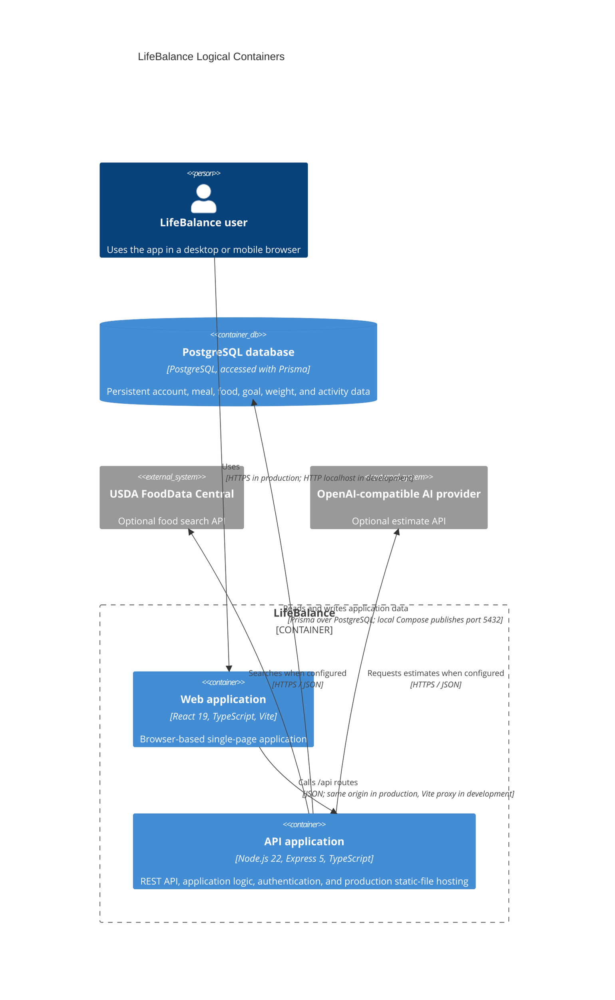

# C4 Level 2: Containers

This is a logical C4 view of the application. The SPA and API are separate logical containers, but the production `Dockerfile` packages the built SPA with the Express API in one application image and one process. Database hosting is separate from that image.

## Runtime mapping

During development, Vite serves the browser app on port 5173 and proxies `/api` to Express on port 3000. In the production image, Express serves the built client files and API from the same process; the Dockerfile defaults to listening on port 10000. The database is a separate PostgreSQL service. The checked-in `compose.yaml` starts only a local PostgreSQL 17 service bound to `127.0.0.1:5432`, not an application service. No live deployment topology is asserted here.
