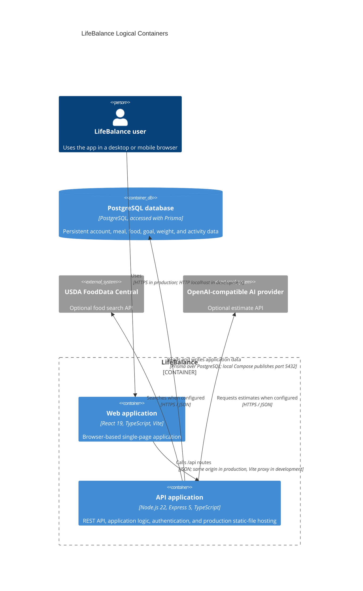

# C4 Level 2: Containers

Reviewed against source on 11 October 2026. This is a logical C4 view of the application. The SPA executes in the user's browser; the Express API executes on the server. The production `Dockerfile` packages the built SPA assets with the Express API in one application image and one server process. Database hosting is separate from that image. Logical C4 containers do not imply separate Docker containers for the client and API.

## Runtime mapping

During development, Vite serves the browser app on port 5173 and proxies `/api` to Express on port 3000. In the production image, Express serves the built client files and API from the same process; the Dockerfile defaults to listening on port 10000. The database is a separate PostgreSQL service. The checked-in `compose.yaml` starts only a local PostgreSQL 17 service bound to `127.0.0.1:5432`, not an application service. No live deployment topology is asserted here.

Internal server modules are not separately deployed services. They share the Prisma repository and local food catalog. GitHub Actions publishes the combined application image to Docker Hub and the configured CD job deploys it to Render; these delivery steps do not move PostgreSQL into the application image. See the [CD guide](../deployment/continuous-deployment.md) for the production delivery procedure.
