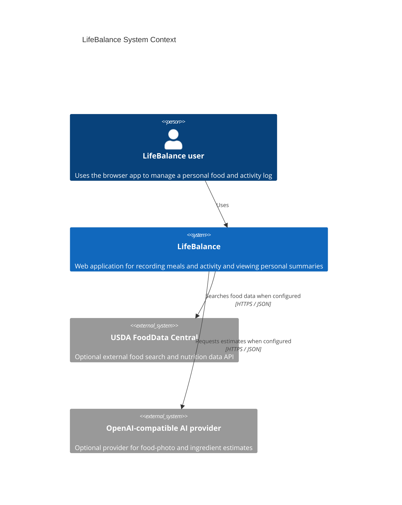

# C4 Level 1: System Context

This view reflects integrations present in the current source. Optional external integrations are not evidence that a provider is configured or reachable in any deployment.

The user personas under `docs/requirements/` are product context only. LifeBalance does not provide clinical or postpartum-care recommendations. Google Fit, Apple HealthKit, SendGrid, and FCM are not current integrations.
