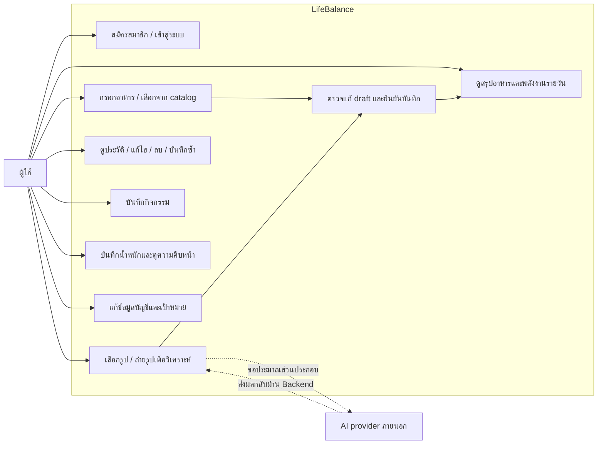
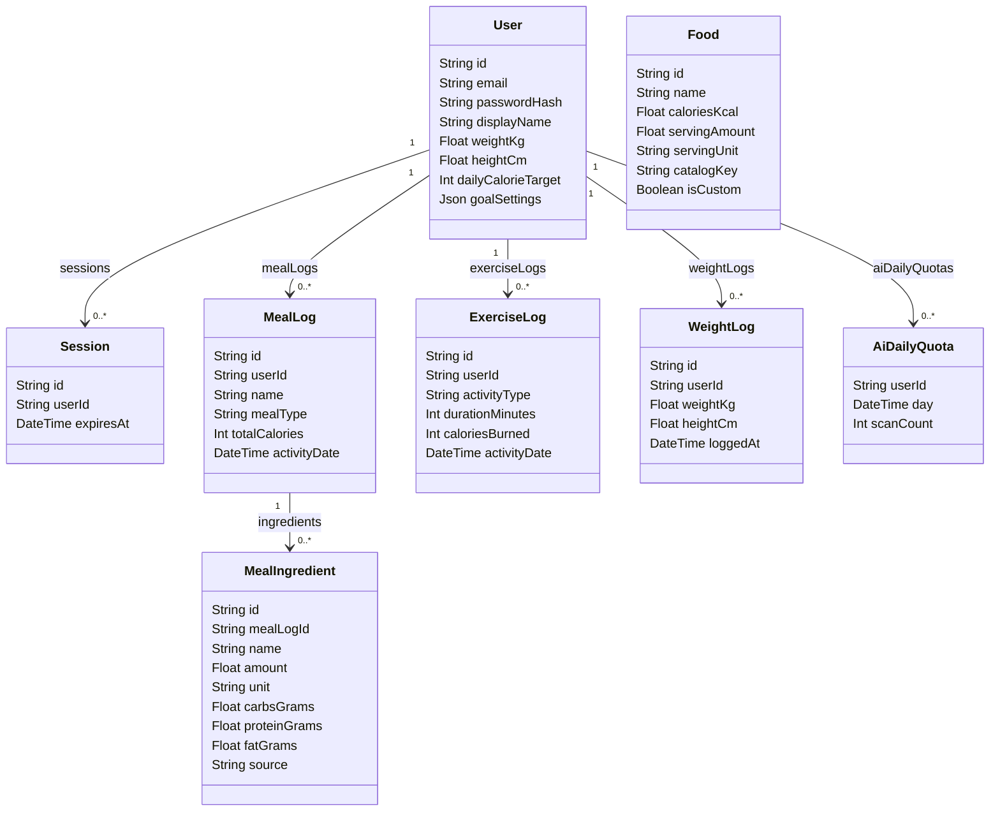

# Use cases และ UML domain model — LifeBalance

อัปเดต 16 ตุลาคม 2569 ตามโครงสร้างโค้ดและ [Prisma schema](../../prisma/schema.prisma) แผนภาพแสดงความสามารถและข้อมูลของระบบ ไม่ใช่ผลทดสอบระบบจริง

## กรณีใช้งานหลัก

ใช้ Mermaid flowchart แสดงภาพรวมกรณีใช้งาน เพื่อให้อ่านได้โดยตรงบน GitHub ส่วนความสัมพันธ์ของข้อมูลใช้ UML class diagram ด้านล่าง

| กรณีใช้งาน | ลำดับหลัก |
|---|---|
| บันทึกอาหารเอง | กรอกชื่อ เลือกมื้อและวันที่ เพิ่มส่วนประกอบ/ปริมาณ คำนวณใหม่เมื่อข้อมูลเปลี่ยน แล้วบันทึก |
| วิเคราะห์ภาพอาหาร | เลือกหรือถ่ายภาพ → Backend เรียก AI และจับคู่ catalog → แสดง draft ให้ผู้ใช้ตรวจแก้ → ผู้ใช้ยืนยันบันทึก |
| จัดการประวัติ | แก้ไขรายการเดิมผ่าน meal editor หรือลบผ่าน flow ยืนยันเดิม; ปุ่ม `+` เปิด draft สำหรับบันทึกซ้ำ ไม่บันทึกทันที |
| กิจกรรมและน้ำหนัก | บันทึกข้อมูลตามวันที่เพื่อใช้แสดงสรุปและประวัติ การบันทึกน้ำหนักไม่เปลี่ยนเป้าหมายพลังงานโดยอัตโนมัติ |
| บัญชีและเป้าหมาย | แก้ข้อมูล/ค่าร่าง และกดบันทึกเป้าหมายจึงส่งข้อมูลไปยัง API |

ขั้นตอนหน้าจอและข้อจำกัดการใช้งานอยู่ใน [คู่มือผู้ใช้](../user-guide.md) การเรียก AI เป็นความสามารถเสริมที่ต้องตั้งค่า provider

## UML class diagram ของข้อมูล

แสดงเฉพาะ field สำคัญของ Prisma models ไม่ใช่รายการ field ทั้งหมด และไม่ได้แสดงว่าแต่ละ model เป็น service แยกกัน

ชนิด nullable, unique constraints, indexes และ field โภชนาการอ้างอิงทั้งหมดดูใน schema ต้นฉบับ `AiDailyQuota` ใช้ composite key จาก `userId` กับ `day` ส่วน `Food` เป็น catalog และไม่มี foreign key เชื่อมกับ `MealIngredient`; รายการมื้ออาหารเก็บค่าปริมาณและโภชนาการอ้างอิงของตนเอง

โครงสร้างการติดตั้งและบริการภายนอกดู [C4 Container](c4-container.md) แนวคิดจากแผนเดิม เช่น การพยากรณ์น้ำหนักด้วย Linear Regression ไม่ใช่ความสามารถที่แผนภาพนี้ยืนยันว่าพัฒนาแล้ว
