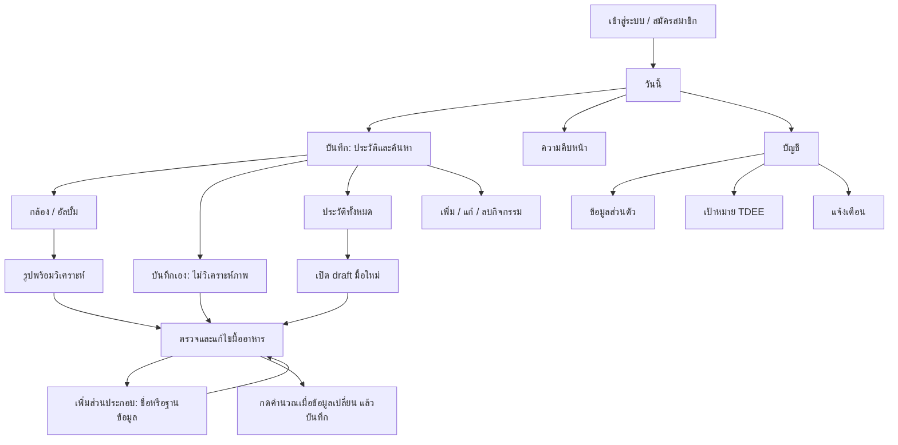

# LifeBalance — UI Design Brief

เอกสารนี้เป็น brief สำหรับออกแบบหน้าจอจากโค้ด client และ shared contracts ใน branch `feature/Chayakorn05` (snapshot วันที่ 7 ต.ค. 2026) ไม่ใช่การยืนยันสถานะ production

อัปเดต UI ตามภาพอ้างอิงวันที่ 7 ต.ค. 2026 บน branch นี้แล้ว เอกสารอธิบายพฤติกรรมปัจจุบันและข้อเสนอสำหรับพัฒนาต่อ ยังไม่ใช่สถานะของเว็บบน Render.

## วิธีอ่านเอกสาร

- **มีในระบบแล้ว** คือ flow, ข้อมูล และข้อจำกัดที่ client ปัจจุบันแสดงหรือรองรับ
- **แนวทางจัด UI ใหม่** คือข้อเสนอการจัดลำดับ/วางหน้าเพื่อให้เป็นระบบเดียวกัน นักออกแบบปรับภาพและ layout ได้โดยคงพฤติกรรมและข้อมูลจริง

หน้าวันนี้แสดงพลังงานที่รับประทานเป็นตัวเด่น วงแหวนแสดงสัดส่วนเทียบเป้าหมาย และแยกพลังงานคงเหลือ/เกินเป้าหมายเป็นการ์ดรอง โดยคงวิธีคำนวณเป้าหมายเดิมไว้

**อัปเดต 8 ต.ค. 2569:** แท่งสารอาหารหน้าวันนี้ใช้ “กินแล้ว / เป้าหมายกรัมต่อวัน” คาร์บส้ม โปรตีนแดง ไขมันเหลือง ตามแนวทางและแคลอรีที่บันทึก ดู [สูตรและข้อจำกัด](../goals.md) หน้าเป้าหมายมีพรีวิวเปอร์เซ็นต์กับกรัมก่อนยืนยัน ส่วนข้อมูลไม่ครบยังแสดงสถานะ ไม่แทนด้วยศูนย์ ช่องค้นหาหน้าบันทึกพื้นขาว ตัวอักษรเข้ม กรอบเขียวเมื่อ focus; ปุ่มเปลี่ยนรูป/ลบรูปอยู่ระดับเดียวกัน ปุ่มกล้องอยู่เหนือเมนูล่างและ error ไม่ซ้ำ หน้าที่โหลดผิดพลาดมีปุ่มลองใหม่ในจุดเดิม วันที่ย้อนหลังใช้หัวเรื่องตามวันที่เลือก และช่องวันที่มีคำอธิบายรูปแบบไทยโดยคง date picker เดิม

## ระบบภาพรวมและหลักการออกแบบ

**Reference หน้าอาหารล่าสุด 8 ต.ค. 2569:** shared meal editor ใช้รูปอาหาร 80–88px คู่ชื่อที่แก้ได้ วันที่ภาษาไทยแสดงจุดเดียวบน native date picker รูปส่วนประกอบจริง/placeholder 48px ชื่อ 14px kcal ด้านขวา หน่วยใกล้ช่องปริมาณ และรายละเอียดขยายภายในแถว การ์ดประมาณ 112px ที่จอ 390/533px และ 134px ที่ 320px ปุ่มเพิ่ม คำนวณ บันทึก ยกเลิกห่าง 8px และ save สูง 50px คง callback/API/สูตรเดิม ดู [ผลทดสอบหน้าอาหารล่าสุด](../testing/meal-editor-reference-2026-10-08.md) ขนาดใหม่นี้แทนค่าของการ์ดในบันทึก audit ก่อนหน้า

**เก็บรายละเอียดหลัง audit 8 ต.ค. 2569:** การ์ดส่วนประกอบอาหารสูงประมาณ 100px ที่จอ 390/533px และ 122px ที่ 320px เมื่อปิดรายละเอียด แสดงชื่อ ปริมาณ แคลอรี แหล่งข้อมูลสั้น ๆ และปุ่มรายละเอียดที่ขยายอยู่ภายในการ์ด ปุ่มย่อยแตะได้อย่างน้อย 44px เมนูล่างและข้อความรองที่ปรับใช้ 12px แถวเวลาเตือนใช้สองคอลัมน์ที่ไม่บีบชื่อมื้อ และเก็บทางออกจากระบบไว้ที่หน้าบัญชีหลัก ผลทดสอบดู [รายงาน UI compact](../testing/compact-ui-fixes-2026-10-08.md)

**ปรับล่าสุด 8 ต.ค. 2569:** ชื่อแท็บแรกเป็น “หน้าแรก” หน้ากล้องขยายเต็มพื้นที่ระหว่างหัวหน้ากับเมนูล่างตามความสูง viewport โดยเผื่อ safe area และคงปุ่มกลับ อัลบั้ม ชัตเตอร์เดิม ไม่จำกัด preview ไว้ที่ 44dvh/430px อีกต่อไป แถบเลือกประวัติรายวันบนหน้าบันทึกถูกนำออกตามคำขอ

**มีในระบบแล้ว:** แอปใช้หัวเรื่องของแต่ละหน้า ปุ่มออกจากระบบอยู่ในบัญชี; แถบนำทาง 4 แท็บคงที่คือ **หน้าแรก / บันทึก / ความคืบหน้า / บัญชี**. แท็บหน้าแรกคือหน้าสรุปพลังงานเดิมของวันนี้และวันที่เลือก หน้า diary มี route ย่อยในแท็บเดียวและปุ่มกลับ. หน้า account เปิดข้อมูลส่วนตัว เป้าหมาย และเตือนมื้ออาหารเป็นหน้าลูกพร้อมปุ่มย้อนกลับในแท็บบัญชี.

**แนวทางจัด UI ใหม่:** คง 4 แท็บนี้เป็นโครงหลักทุกขนาดจอ; ใช้ชื่อหน้าชัดเจน, ปุ่มย้อนกลับในหน้าลูก, และเก็บค่าฟอร์มไว้เมื่อบริการล้มเหลว. ออกแบบหน้าแบบฟอร์มและรายละเอียดเป็นหน้าหรือแผงเต็มที่มีหัวเรื่อง/ปุ่มกลับชัด แทนการอัดทุกส่วนลงการ์ดหรือ modal ขนาดเล็ก; ส่วน account ใช้หน้าลูกแล้ว ส่วน diary ยังคง route ย่อยในแท็บบันทึก. ลำดับที่แนะนำคือหัวเรื่อง → ข้อมูลสำคัญ → ฟอร์ม/รายการ → action หลัก.

โทนสว่างและสงบ: พื้นหลังเขียวอ่อน `#ffffff`, การ์ดขาว `#fff`, ตัวอักษร `#192b20`, ข้อความรอง `#596c60`, เขียวหลัก `#009b45`, เส้นขอบ `#dcebdc`. ใช้สีเขียวกับ action หลักและสถานะสำเร็จ; สีเตือน/ผิดพลาดต้องมีข้อความกำกับไม่พึ่งสีอย่างเดียว. ขนาดตัวอักษรหลัก 14–16px ข้อความรอง 12–13px; พื้นที่แตะอย่างน้อย 44px, ช่องตัวเลขแสดงหน่วยใกล้ label. รักษา focus, label, disabled/loading state, ความต่างสีและอ่านข้อความด้วย screen reader.

## รายการหน้าจอ

| # | หน้าจอ / จุดเข้า | เป้าหมายหลัก |
|---|---|---|
| 1 | เข้าสู่ระบบ / สมัครสมาชิก | ยืนยันตัวตนและสร้างบัญชี |
| 2 | เริ่มระบบ / เชื่อมต่อผิดพลาด | แสดงสถานะ session และลองใหม่ |
| 3 | วันนี้ | ดูพลังงานและสารอาหารของวันที่เลือก |
| 4 | บันทึก: หน้าแรก | เริ่มบันทึก, ดูประวัติล่าสุด, ค้นอาหาร |
| 5 | กล้อง / เลือกภาพ | ถ่ายหรือเลือกรูปอาหาร |
| 6 | ตรวจสอบ / แก้ไขอาหาร | ทบทวนรายการก่อนบันทึก หรือแก้รายการเดิม |
| 7 | เลือกส่วนประกอบจากแค็ตตาล็อก | เลือกอาหารพร้อมปริมาณกรัม |
| 8 | ประวัติอาหารทั้งหมด | ค้นหาและนำมื้อเดิมกลับมาใช้ |
| 9 | กิจกรรม | เพิ่ม แก้ไข หรือลบกิจกรรมรายวัน |
| 10 | ความคืบหน้า: น้ำหนัก/BMI | ดูข้อมูลรายวันย้อนหลังและเทียบเป้าหมาย |
| 11 | สรุปรายสัปดาห์ | ดูพลังงาน 7 วันและวันที่มีบันทึก |
| 12 | บัญชี / ข้อมูลโปรไฟล์ | ดูหรือแก้ข้อมูลร่างกาย |
| 13 | เป้าหมายสุขภาพ | ตั้ง TDEE/พลังงาน/น้ำหนักเป้าหมาย |
| 14 | เตือนมื้ออาหาร | ตั้งเวลาเตือนบนอุปกรณ์นี้ |

จำนวนนี้แยก state ที่มีพฤติกรรมหรือข้อมูลต่างกันให้ผู้ออกแบบทำงานได้; บางรายการปัจจุบันยังแสดงเป็น component inline ไม่ใช่หน้าแยก.

## รายละเอียดหน้าจอและสถานะ

### 1. เข้าสู่ระบบ / สมัครสมาชิก

**มีในระบบแล้ว:** มีสวิตช์สองโหมด อีเมลและรหัสผ่าน; สมัครเพิ่มชื่อที่ใช้แสดงและยืนยันรหัสผ่าน. รหัสผ่าน 8–128 ตัวอักษร; อีเมลตรวจรูปแบบ. สมัครเสร็จกลับสู่โหมด login ให้เข้าสู่ระบบเอง. มีสถานะกำลังดำเนินการ, ข้อผิดพลาดระดับฟอร์ม/ช่องกรอก และข้อความสำเร็จ.

**แนวทางจัด UI ใหม่:** จอเริ่มต้นไม่ต้องมีแท็บหลัก; วางแบรนด์และคำอธิบายสั้น แล้วการ์ดฟอร์ม. ปุ่มหลักเปลี่ยนตามโหมด, สลับ login/register เป็น action รอง. แสดง validation ใต้ช่องและรักษาข้อมูลที่กรอกเมื่อ request ผิดพลาด. ไม่มี social login หรือ reset-password flow.

### 2. เริ่มระบบ / การเชื่อมต่อ

**มีในระบบแล้ว:** ขณะตรวจ session แสดง “กำลังโหลดข้อมูล”; error ที่ไม่ใช่ 401 แสดง “ยังเชื่อมต่อระบบไม่ได้” พร้อมลองอีกครั้ง. 401 หมายถึงผู้ใช้ยังไม่ login และเข้าสู่หน้าล็อกอินตามปกติ.

**แนวทางจัด UI ใหม่:** ใช้สถานะเต็มพื้นที่พร้อมคำอธิบายสั้นและปุ่ม retry; ระหว่างโหลดไม่แสดงข้อมูลเก่าราวกับเป็นข้อมูลล่าสุด.

### 3. วันนี้

**ปรับ 8 ต.ค. 2569 — อาหารของวันที่เลือก:** โลโก้ระบบอยู่หน้าคำทักทาย หัวรายการใช้ “อาหาร · วันที่” พร้อมจำนวนและปุ่มเพิ่มรายการ การ์ดมีรูปจริงหรือ placeholder ชื่อ พลังงาน ส่วนประกอบย่อ และแถวแก้ไข/ลบ พื้นที่หลักของการ์ดกับปุ่มแก้ไขเปิด MealPanel เดิม ปุ่มเพิ่มและ CTA ด้านล่างเริ่มฟอร์มด้วยวันที่ที่กำลังดู บันทึกสำเร็จกลับหน้าสรุปของวันเดิม; เปลี่ยนวันที่ในฟอร์มไม่เลื่อนวันที่ที่หน้าแรกกำลังดู การลบยืนยันตาม flow ประวัติเดิมและโหลดจำนวน พลังงาน และสารอาหารใหม่ ถ้าบันทึกไม่ผ่านคง draft ถ้าลบไม่ผ่านคงรายการพร้อม error ไม่เพิ่ม route หรือ API ใหม่

**มีในระบบแล้ว:** ทักทายด้วย display name; มี date picker. แสดงพลังงานที่กิน, เผาผลาญ, พลังงานสุทธิ, พลังงานที่ยังรับประทานได้/เกินเป้า, คาร์บ โปรตีน ไขมัน, BMI และจำนวนมื้อ. ปุ่มลัดไปบันทึกอาหาร. ถ้ามี goal settings ใหม่ การออกกำลังกายเป็นข้อมูลประกอบและไม่บวกซ้ำเข้ากับงบเป้าหมาย; goal แบบเดิมคงการนับ net calories.

**แนวทางจัด UI ใหม่:** ดัน “รับประทานแล้ว X kcal จากเป้าหมาย Y” ขึ้นเป็น metric หลัก; แสดงคงเหลือ/เกินเป็น metric คู่ พร้อม progress bar ที่มีค่าตัวเลข. แยกสรุปออกกำลังกายและ macros เป็นการ์ดรอง. ระบุวันที่และที่มาของงบเป้าหมาย; ไม่ซ่อนกรณียังไม่ได้ตั้งเป้า. มี loading, error พร้อม retry และ empty day ที่ชวนเพิ่มอาหาร/กิจกรรม. ถ้าเลือกทำ TDEE แบบรวมกิจกรรม ให้สื่อสารชัดว่าระบบไม่นำ kcal ออกกำลังกายมาบวกซ้ำ.

### 4. บันทึก: หน้าแรกและการค้น

**มีในระบบแล้ว:** Landing ของ Diary เป็นหน้าเริ่มต้น ไม่ใช่ date picker หรือรายการมื้อที่ใช้บ่อย. เอาแถบวันนี้/เมื่อวาน/เลือกวันที่/ประวัติทั้งหมดและหน้าประจำวันที่เข้าจากแถบนี้ออกตามคำขอ 8 ต.ค. 2569 มี search ช่องเดียวที่ค้นประวัติและ catalog, action ถ่ายภาพ, กรอกอาหารเอง, บันทึกกิจกรรม และประวัติย้อนหลัง 30 วัน; ปุ่มดูทั้งหมดเปิดประวัติเต็ม. เมื่อ query มีอย่างน้อย 2 ตัวอักษร ค้น catalog และแสดงแหล่งข้อมูล/พลังงานต่อ 100g; รายการสารอาหารไม่ครบเลือกไม่ได้. ประวัติใช้ query เดียวกัน, เรียง/โหลดแบบแบ่งหน้า (ปกติ 20 รายการ, เพิ่มได้ครั้งละหน้า, สูงสุดต่อ request 50); การค้นประวัติครอบคลุมช่วงทั้งหมดที่ระบบร้องขอ.

**แนวทางจัด UI ใหม่:** ให้ search แสดงผลสองกลุ่มที่แยกหัวข้อชัด: “ประวัติของคุณ” กับ “ฐานข้อมูลอาหาร”. ในประวัติแต่ละแถวให้เห็นชื่อ, วันที่, มื้อ, kcal, รูปถ้ามี และ action “บันทึกมื้อนี้อีกครั้ง”. แสดงโหลด, ไม่พบ, โหลดเพิ่ม, และ retry แยกตามกลุ่ม. ไม่ใส่ตัวกรองวันเป็น landing ใหม่; วันที่และมื้ออยู่ใน editor.

### 5. กล้อง / เลือกรูป

**มีในระบบแล้ว:** route กล้องใช้กล้องหลังเมื่อเบราว์เซอร์รองรับ; มีชัตเตอร์และเลือกจากอัลบั้ม. ถ้าไม่มี API/ไม่อนุญาต ใช้ข้อความและเลือกอัลบั้มแทน. รูปถูกย่อก่อนส่ง; เมื่อเตรียมสำเร็จเปิดแบบฟอร์มภาพเพื่อกดวิเคราะห์หรือกรอกเอง. การย่อ/โหลด/วิเคราะห์ผิดพลาดต้องคงรูปหรือข้อมูลที่กรอกเท่าที่ทำได้.

**แนวทางจัด UI ใหม่:** พื้นที่ preview ใหญ่, ปุ่มถ่ายหลักชัด, album เป็นทางเลือกรอง, กลับไป Diary อยู่ด้านบน. กรณี permission denied ให้บอกวิธีอนุญาตและมีทางเลือก album; ไม่ค้างกับ spinner.

### 6. ตรวจสอบ/แก้ไขมื้ออาหาร และ AI

**มีในระบบแล้ว:** Editor มีวันที่, มื้อ (เช้า/กลางวัน/เย็น/ของว่าง), ชื่ออาหาร, รูป, ingredient rows, nutrition totals, เพิ่ม/ลบ/แก้ปริมาณ และปุ่มบันทึกแบบ explicit. ภาพ AI เป็นเพียงค่าประมาณ ต้องให้ผู้ใช้ตรวจและยืนยันบันทึก; ระหว่างวิเคราะห์แสดงเวลารอและห้ามกดซ้ำ. แสดง source badge ต่อส่วนประกอบ: AI estimate, USDA FoodData Central, food catalog, manual หรือ legacy. กรณีแก้ชื่อหลังวิเคราะห์ มีทางเลือกบันทึกชื่ออย่างเดียว หรือวิเคราะห์รูปใหม่ตามชื่อ; วิเคราะห์ใหม่ใช้โควตาอีกครั้งและแทนส่วนประกอบทั้งหมดรวมถึงปริมาณที่แก้ไว้ จึงต้องเตือนก่อน action นั้น. ถ้าวิเคราะห์ล้มเหลว รูปและข้อมูลที่กรอกยังอยู่; ลองใหม่ใช้โควตาอีกครั้ง หรือเลือกกรอกเอง. รูปอาจลบออกก่อนบันทึก.

**แนวทางจัด UI ใหม่:** เรียงจากรูป/ชื่ออาหาร → พลังงานรวมของมื้อ → คาร์บ/โปรตีน/ไขมันรวม → ส่วนประกอบแต่ละรายการ → เพิ่มส่วนประกอบ → คำนวณใหม่/บันทึก. แต่ละส่วนประกอบมีชื่อ ปริมาณกรัม แคลอรี และปุ่มลบ; ไม่ใช้ปุ่มเลือกอาหารทดแทน. วันที่และมื้ออยู่ในส่วนข้อมูลมื้อที่เปิดแก้ได้ โดยไม่แย่งความเด่นจากสารอาหาร. ก่อน save ให้ตรวจชื่อ/วัน/มื้อและผลรวมได้. AI/catalog match เป็นป้ายพร้อมคำเตือน “ปริมาณจากภาพยังเป็นค่าประมาณ” หรือสถานะจับคู่ไม่สำเร็จ. การแก้ปริมาณ เพิ่ม หรือลบ ingredient ทำให้ผลรวมรอคำนวณ; แสดงปุ่มคำนวณใหม่และปิดการบันทึกจนกดคำนวณสำเร็จ. เมื่อสำเร็จแจ้งบันทึกแล้ว; เมื่อผิดพลาดรักษาข้อมูลและชี้ field.

**แยกโหมดให้ชัด:** เข้า “บันทึกอาหารเอง” แล้วแนบรูปได้โดยไม่ส่งรูปวิเคราะห์ AI; รูปไม่บังคับ และผู้ใช้เลือกชื่ออาหารกับส่วนประกอบเอง. เข้า “ถ่ายภาพอาหาร” แล้วถ่าย/เลือกรูป จะเปิด editor โหมดภาพ และยังต้องกด “วิเคราะห์รูป” เองก่อนใช้ AI. การเพิ่มส่วนประกอบด้วยชื่อในทั้งสองโหมดอาจใช้ AI ประมาณจากข้อความเมื่อฐานข้อมูลหาไม่พบ ซึ่งต่างจากการวิเคราะห์ภาพ.

**รูปที่บันทึก:** โค้ดรองรับเก็บภาพที่ย่อแล้วกับรายการอาหารใน `MealLog.imageData` และนำมาแสดงในรายการ/มื้อที่ใช้ซ้ำ. ยังไม่ได้ใช้ Supabase Storage; รูปจาก catalog ที่ใช้แสดงเป็นตัวอย่างไม่ได้เท่ากับภาพส่วนตัวที่อัปโหลด. ข้อนี้เป็นความสามารถจากโค้ด ไม่ใช่ผลตรวจการเก็บภาพบน production.

**การคำนวณจริง:** ต่อสารอาหารของแต่ละ ingredient คำนวณจาก reference nutrients × จำนวนปัจจุบัน / จำนวนอ้างอิง แล้วรวมทั้งมื้อ. ตัวอย่าง ข้าว 200 กรัมมีพลังงาน 260 kcal; แก้เหลือ 100 กรัมแล้วกดคำนวณใหม่จะเหลือ 130 kcal และสารอาหารของข้าวลดครึ่งหนึ่ง โดยส่วนประกอบอื่นไม่เปลี่ยน. แสดงไม่ทราบเมื่อข้อมูลอ้างอิงเป็น null; ห้ามแทนค่าไม่ทราบด้วยศูนย์โดยไม่ติดป้าย. มื้อที่สารอาหารส่วนประกอบไม่ครบยังบันทึกไม่ได้. สัญญาข้อมูลรองรับ source `manual` ที่สารอาหารครบต่อ 100 กรัม แต่ไม่มีช่องกรอกตัวเลขเหล่านี้ในหน้าปัจจุบัน. ข้อมูลเก่าแบบ legacy serving อาจไม่ทราบน้ำหนักเป็นกรัม จึงต้องแสดง “ส่วนเดิม” ไม่แต่งค่าแปลงเป็นกรัม. ส่วนประกอบสูงสุด 20 รายการ, อย่างน้อย 1 รายการในการบันทึก.

### 7. เพิ่มส่วนประกอบ / เลือกอาหาร

**มีในระบบแล้ว:** จาก editor เปิด inline search catalog พร้อม amount กรัม (1–10,000); แสดงค่าต่อ 100g, แหล่งข้อมูล และ URL ถ้ามี. รายการสารอาหารไม่ครบปิดการเลือก. อีก flow ให้กรอกชื่อและกรัม แล้วระบบค้น catalog ก่อน; ถ้าไม่พบ AI ประมาณสารอาหาร. Flow นี้ไม่ใช่ช่องกรอกสารอาหารละเอียดด้วยตัวเอง. แสดงสถานะกำลังค้น/ประมาณและ error โดยคง input.

**แนวทางจัด UI ใหม่:** ให้ picker เป็นหน้าหรือแผงเต็มตามข้อเสนอด้าน layout, ใส่ช่องค้น, ปริมาณ (g), ผลลัพธ์และ source; เมื่อเลือกให้กลับ editor พร้อมรายการที่เพิ่มและข้อความยืนยัน โดยผลรวมยังเป็น “รอคำนวณใหม่” ตามกฎปัจจุบัน. ออกแบบกรณีค้นไม่พบและข้อมูล incomplete แยกกัน. ไม่มี food replacement flow โดยเฉพาะ; เปลี่ยน ingredient ด้วยการลบและเพิ่มรายการใหม่. สัญญาข้อมูลรองรับ source `manual` ที่มีสารอาหารครบต่อ 100 กรัม แต่ไม่มีแบบฟอร์มให้ผู้ใช้กรอกตัวเลขสารอาหารเองใน UI ปัจจุบัน; หากต้องการให้กรอกเองโดยตรงให้ถือเป็น requirement ใหม่.

### 8. ประวัติอาหารทั้งหมด

**มีในระบบแล้ว:** เข้าจาก “ดูทั้งหมด”; ค้นหาประวัติ, รายการมีชื่อ/รูป, ปริมาณรวมโดยประมาณ, kcal, วันที่และมื้อ; ปุ่ม + นำมื้อมาเป็น draft editor เพื่อบันทึกซ้ำ. แบ่งหน้าด้วย “ดูประวัติเพิ่ม”, loading, error/retry และ empty state. การแก้/ลบอยู่ใน MealList ของ editor ตามวันที่เลือก ไม่ใช่ action ใน history list.

**แนวทางจัด UI ใหม่:** รักษา history row แบบอ่านง่าย, ให้ duplicate action สื่อว่าเปิด draft เพื่อตรวจ/แก้ก่อน save; อย่าทำให้ดูเหมือนบันทึกซ้ำทันที. วันที่มื้อใหม่เป็นค่าของ editor ไม่ใช่ตัวกรอง landing.

### 9. กิจกรรม

**มีในระบบแล้ว:** route จาก Diary มี date, daily calories consumed/burned/net; เลือกเดินเร็ว วิ่ง ปั่นจักรยาน โยคะ หรือเวทเทรนนิ่ง และระยะเวลา 1–1440 นาที. บันทึกใช้ weight ล่าสุดคำนวณ kcal; ถ้าไม่มีน้ำหนักบันทึกปุ่มใช้ไม่ได้. รายการของวันที่เลือกมีแก้ไข/ลบ; editor แก้ activity type และ duration. มีข้อความผิดพลาด/empty และ busy state ระหว่างบันทึก; การโหลดสรุปครั้งแรกยังไม่ได้มีตัวโหลดแยกชัดเจน.

**แนวทางจัด UI ใหม่:** วางตัวเลือกกิจกรรมและ duration เป็นฟอร์มสั้นด้านบน; รายการวันที่เลือกด้านล่างพร้อมนาทีและ kcal. สรุปพลังงานเป็นส่วนรอง และควรมี loading แยกเพื่อไม่ทำให้ค่าเริ่มต้น 0 ดูเหมือนโหลดข้อมูลสำเร็จแล้ว. Editing เปลี่ยน CTA เป็น “บันทึกการแก้ไข” และมี cancel. ยืนยันข้อความเมื่อบันทึกหรือลบ; ลบเป็น action แยกที่มองเห็นชัด.

### 10. ความคืบหน้าน้ำหนัก/BMI

**มีในระบบแล้ว:** แท็บ Progress แสดงแนวโน้มน้ำหนักและ BMI ย้อนหลังหนึ่งปี, น้ำหนักล่าสุดของแต่ละวัน; สรุปน้ำหนักเริ่มต้น ปัจจุบัน เป้าหมาย และการเปลี่ยนจากเริ่มต้น. กราฟเส้นมีแกน หน่วย และเส้นน้ำหนักเป้าหมาย สลับน้ำหนัก/BMI และเลือกช่วง 1/3/6 เดือนหรือ 1 ปีได้; ไม่มีข้อมูลให้บันทึกน้ำหนักผ่าน Account. มี error/loading/empty.

**แนวทางจัด UI ใหม่:** เริ่มด้วย summary metrics และกราฟที่มีแกน/หน่วย/วันที่อ่านได้บนมือถือ; ระบุว่าข้อมูลมาจาก profile history และวันที่ละค่าสุดท้าย. อย่าสื่อแนวโน้ม/การเปลี่ยนแปลงเมื่อไม่มีจุดข้อมูล.

### 11. สรุปพลังงาน 7 วัน

**มีในระบบแล้ว:** เลือกวันสิ้นสุดและดู 7 วันย้อนหลัง; แสดงจำนวนวันที่บันทึกอาหาร, ค่าเฉลี่ยเทียบเป้าหมายเฉพาะวันที่มีอาหาร, ยอดรวม และแท่งคู่รับประทาน/เผาผลาญ. การเปรียบเทียบใช้เป้าหมายปัจจุบัน ไม่ใช่เป้าหมาย ณ วันนั้น; วันที่ไม่มีอาหารแยกเป็น unlogged. เมื่อยังไม่มีเป้าหมายหรือรายการ ให้แสดง —/ข้อความ empty.

**แนวทางจัด UI ใหม่:** ใส่หมายเหตุเรื่อง “เป้าหมายปัจจุบัน” ใกล้ค่าเฉลี่ย, label สี/legend ของแท่งและหน่วย kcal, และ tooltip/รายละเอียดวันสำหรับกราฟมือถือ. ห้ามตีความวันไร้ข้อมูลเป็นศูนย์การกิน.

### 12. บัญชี / แก้โปรไฟล์

**มีในระบบแล้ว:** แท็บ Account แสดง display name, email; ขยายข้อมูลล่าสุด age, weight kg, height cm, BMI. เมนูเปิดหน้าลูก: โปรไฟล์, เป้าหมาย, เตือนมื้ออาหาร พร้อมย้อนกลับบัญชี. แบบฟอร์มโปรไฟล์: display name, อายุ 1–120 ปี, น้ำหนัก >0 ถึง 500 กก., ส่วนสูง 30–250 ซม.; save อัปเดต BMI/ประวัติตามข้อมูลและแจ้งสำเร็จ/error. ออกจากระบบอยู่หัวหน้าบัญชี และหน้าแก้ข้อมูลส่วนตัว.

**แนวทางจัด UI ใหม่:** แสดง profile summary และปุ่ม “แก้ข้อมูล” ให้ชัด; ข้อมูลว่างใช้ “ยังไม่ระบุ” และบอกหน่วย. หลังบันทึกแสดงค่าที่ปรับแล้วและสถานะสำเร็จ. หน้า account ไม่ควรแสดงข้อมูลจำลองหรือ editable field ก่อนเข้าหน้าแก้ไข.

### 13. เป้าหมายสุขภาพ / TDEE

**มีในระบบแล้ว:** มี 3 โหมด รักษาน้ำหนัก, ลดน้ำหนัก, เพิ่มกล้ามเนื้อ; เลือกเพศที่ใช้ในสูตร, ระดับกิจกรรมต่ำ/ปานกลาง/สูง, เลือกค่าแนะนำหรือกำหนด kcal เอง (1,000–10,000), น้ำหนักเป้าหมาย (กก.). ระบบแสดง TDEE และเป้าหมายประมาณ (คงที่ 100% TDEE, ลด 90%, เพิ่มกล้าม 105%); ต้องกดบันทึกจึงใช้ค่า. Profile ต้องมีอายุ/น้ำหนัก/ส่วนสูงและอายุอย่างน้อย 18 เพื่อ estimate; BMI <18.5 กันโหมดลดน้ำหนัก. แจ้งเมื่อ profile เปลี่ยนจาก snapshot และมีปุ่มใช้ค่าประมาณใหม่; manual target ยังเป็นทางเลือก. มีคำเตือนค่าประมาณไม่รับประกันผลและไม่ใช่คำแนะนำแพทย์; ใช้ได้กับผู้ใหญ่ที่ไม่ได้ตั้งครรภ์/ให้นมบุตร.

**แนวทางจัด UI ใหม่:** เริ่มด้วยการ์ด TDEE เป็นค่ามาตรฐาน → เป้าหมาย 3 ตัวเลือก → เป้าพลังงานที่ได้จากโหมดนั้น → น้ำหนักเป้าหมาย → ปุ่มบันทึก. ตั้งค่าครั้งแรกต้องเลือกเพศสำหรับสูตรและระดับกิจกรรมก่อนจึงแสดง TDEE ได้; แสดงสองช่องนี้พร้อมข้อความอธิบายเมื่อข้อมูลยังไม่ครบ และเสนอให้ยุบเป็น “ข้อมูลที่ใช้คำนวณ” หลังตั้งค่าแล้ว. ตัวเลือกกำหนด kcal เองเป็นส่วนขยาย ไม่ต้องแย่งความเด่นจากค่ามาตรฐาน. แสดงหน่วย kcal/วันตลอด. ให้ผู้ใช้เห็นค่าที่จะเปลี่ยนและกดยืนยัน explicit; หาก profile เปลี่ยนให้เปรียบเทียบค่าเดิมกับค่าใหม่ก่อน apply. เมื่อ input ไม่พอให้บอก link ไปเติมข้อมูลโปรไฟล์. พลังงานจากกิจกรรมรวมใน factor ของระดับกิจกรรม; หน้าสรุปเมื่อใช้ goal settings ใหม่จึงไม่นำ exercise calories มาบวกซ้ำ.

**เงื่อนไขที่มีผลกับปุ่ม:** ใน client ปัจจุบัน แม้เลือกกำหนด kcal เอง ปุ่มบันทึกยังต้องมีค่าประเมินที่คำนวณได้; ไม่ใช่ทางข้ามเงื่อนไขอายุ/ข้อมูลร่างกาย/เพศสำหรับสูตร. ต้องออกแบบข้อความบอกสิ่งที่ยังขาดให้เห็นก่อนถึงปุ่มที่ปิดอยู่.

### 14. เตือนมื้ออาหาร

**มีในระบบแล้ว:** ตั้งเวลา 3 มื้อด้วย time inputs. บันทึกบนอุปกรณ์/browser ของ user (local storage keyed by user), ไม่ใช่ setting ที่ sync ข้ามเครื่อง. ต้องอนุญาต browser notification; แจ้งเตือนอาศัยแอป/หน้าเว็บเปิดค้างและอาจหยุดเมื่อ browser พัก. ถ้า denied ให้เปิด permission ใน browser settings; ถ้าไม่รองรับ/ไม่ใช่ HTTPS หรือ localhost แจ้งข้อจำกัด. เปิด/ปิดแยกได้และการแก้เวลา save ทันที.

**แนวทางจัด UI ใหม่:** แสดง scope “อุปกรณ์นี้” ใต้หัวข้อ, เวลาแต่ละมื้อ, ปุ่มเปิด/ปิด permission และสถานะ granted/denied/unsupported. ยืนยันเมื่อบันทึกหรือแจ้งวิธีแก้เมื่อบันทึก local ไม่สำเร็จ. อย่าสื่อว่าเป็น push notification หรือ sync ระดับบัญชี.

## Flows สำคัญสำหรับทำ prototype

1. **ถ่ายภาพ → วิเคราะห์ → ตรวจ → save:** Diary > กล้อง/album > preview ใน editor > analyze loading > ปรับชื่อ/มื้อ/ปริมาณ/ลบหรือเพิ่ม ingredient > ตรวจ total/source > บันทึก explicit > success. ทดลอง AI failure, retry warning เรื่อง quota, คำเตือน inline ก่อนกดวิเคราะห์ใหม่ตามชื่อที่แก้ (ไม่ใช่ modal ในปัจจุบัน) และการแก้ ingredient ที่ต้องกด recalculate ก่อน save.
2. **บันทึกเอง → อาหาร catalog/manual estimate:** Diary > กรอกเอง > เลือก date+meal > search catalog และกำหนดกรัม หรือเพิ่มจากชื่อ+กรัมให้ระบบค้น/estimate > ตรวจ source และ nutrient completeness > save. ห้ามแสดงว่า manual name-entry เป็นค่าที่ผู้ใช้กรอก nutrients เอง.
3. **ค้นประวัติ → บันทึกซ้ำ:** Diary landing (recent 30 days) หรือ history all > ค้น > แตะ + > ได้ draft ใน editor > กำหนดวัน/มื้อและแก้ข้อมูล > save. Search catalog ควบคู่แต่แยกผลลัพธ์จากประวัติ.
4. **กิจกรรมและพลังงาน:** Diary > activity > date/type/minutes > save > dashboard/summary refresh. เปรียบเทียบทั้ง goal settings ใหม่และบัญชีเดิมเพื่อเห็นกฎการนับ calories ต่างกัน.
5. **เปลี่ยนข้อมูล/เป้าหมาย:** Account > profile update > trend refresh; เป้าหมาย > เลือก mode/settings > ดูค่าคำนวณ/คำเตือน > explicit save > Today และ Progress ใช้ goal snapshot ล่าสุด.

ไม่มีเป้าหมายรายวันเป็นกรัมสำหรับคาร์บ/โปรตีน/ไขมันใน goal settings ปัจจุบัน; macros ใน Today เป็นผลรวมอาหารที่บันทึกเท่านั้น.

## ลำดับองค์ประกอบสำหรับวาดหน้าจอ

ตารางนี้เป็น **โครง UI ที่เสนอ** สำหรับทำ wireframe และ prototype. แยกหน้าที่ใช้ component ร่วมกันเป็นหลายภาพได้ เพื่อให้เห็นแต่ละขั้นตอนจริง; ไม่ได้หมายความว่ามี route แยกเหล่านี้ในแอปแล้ว. เรียงรายการจากบนลงล่าง และคงพื้นที่ท้ายหน้าให้ปุ่ม/แถบนำทางไม่บังข้อมูล.

| ภาพหน้าจอที่ควรทำ | องค์ประกอบจากบนลงล่าง | ปุ่มหลัก / การกลับ |
|---|---|---|
| เข้าสู่ระบบ | แบรนด์ → คำต้อนรับสั้น → อีเมล → รหัสผ่าน → ข้อความผิดพลาด → ปุ่มเข้า → ลิงก์สมัคร | เข้าสู่ระบบ / สลับสมัครสมาชิก |
| สมัครสมาชิก | แบรนด์ → ชื่อที่ใช้แสดง → อีเมล → รหัสผ่าน → ยืนยันรหัสผ่าน → ข้อผิดพลาดใต้ช่อง | สร้างบัญชี / กลับเข้าสู่ระบบ |
| วันนี้ | ชื่อผู้ใช้และวันที่ → kcal รับประทาน/เป้าหมาย → คงเหลือหรือเกิน → คาร์บ/โปรตีน/ไขมัน → กิจกรรมประกอบ → BMI/จำนวนรายการ | บันทึกอาหารของวันนี้ / 4 แท็บหลัก |
| บันทึก: หน้าแรก | ชื่อหน้า → ค้นหาประวัติ/ฐานข้อมูล → ถ่ายภาพ・บันทึกเอง・กิจกรรม → ประวัติอาหารพร้อมดูทั้งหมด → โหลดเพิ่ม | เลือกวิธีบันทึก หรือ + ที่มื้อเก่าเพื่อเปิด draft |
| ผลค้นหาในหน้าบันทึก | ช่องค้นพร้อมข้อความที่พิมพ์ → กลุ่มประวัติของคุณ → กลุ่มฐานข้อมูลพร้อมแหล่งข้อมูล/ค่าต่อ 100 กรัม → สถานะโหลด/ไม่พบแยกกลุ่ม | ใช้มื้อจากประวัติ หรือใช้อาหารจากฐานข้อมูล |
| กล้อง | ปุ่มกลับ/ชื่อหน้า → ภาพกล้องใหญ่ → ข้อความเปิดกล้อง/สิทธิ์ → แถวควบคุม: อัลบั้มซ้าย・ชัตเตอร์กลาง | ถ่ายภาพ / อัลบั้ม / กลับบันทึก |
| รูปพร้อมวิเคราะห์ | กลับ → ตัวอย่างรูป → ปุ่มลบ/เปลี่ยนรูป → ข้อความว่าผลยังเป็นค่าประมาณ → วิเคราะห์ หรือเพิ่มข้อมูลเอง | วิเคราะห์รูป; ยังไม่บันทึกมื้อ |
| กำลังวิเคราะห์ | รูปที่เลือก → สถานะกำลังวิเคราะห์ → เวลาที่รอ → คำอธิบายให้รอโดยไม่กดซ้ำ | ปิดปุ่มวิเคราะห์ซ้ำและบันทึกระหว่างประมวลผล |
| ผลวิเคราะห์/ตรวจอาหาร | รูปและชื่อแก้ได้ → kcal รวม → macros รวม → ส่วนประกอบพร้อมกรัม/kcal/ที่มา/ลบ → เพิ่มส่วนประกอบ → วันและมื้อ → บันทึก | บันทึก หรือคำนวณใหม่เมื่อข้อมูลเปลี่ยน |
| แก้ชื่อที่ AI ทายผิด | ชื่อที่แก้ → คำเตือนว่าแค่แก้ชื่อไม่เปลี่ยนส่วนประกอบ → ทางเลือกวิเคราะห์ตามชื่อใหม่พร้อมแจ้งโควตาและสิ่งที่จะถูกแทนที่ | วิเคราะห์ใหม่ตามชื่อ หรือคงส่วนประกอบแล้วบันทึก |
| บันทึกอาหารเอง | กลับ/ชื่อหน้า → รูปไม่บังคับ → ชื่ออาหาร → kcal/macros → รายการส่วนประกอบ/เพิ่ม → วัน/มื้อ → บันทึก | เพิ่มส่วนประกอบและคำนวณ; ไม่มีปุ่มวิเคราะห์ภาพในโหมดนี้ |
| เพิ่มส่วนประกอบด้วยชื่อ | กลับ/ปิด → คำอธิบายค้นฐานข้อมูลก่อนและอาจใช้ AI → ชื่อส่วนประกอบ → กรัม → สถานะประมาณ/ข้อผิดพลาด | ประมาณและเพิ่ม / ค้นหาจากฐานข้อมูลแทน |
| เลือกส่วนประกอบจากฐานข้อมูล | กลับ/ปิด → ช่องค้นและปุ่มค้น → กรัมที่ต้องการ → ผลลัพธ์พร้อมสารอาหารต่อ 100 กรัม/แหล่งข้อมูล → ข้อผิดพลาด | เลือกรายการที่ข้อมูลครบ; กลับ editor แล้วคำนวณใหม่ |
| ประวัติทั้งหมด | กลับ/ชื่อหน้า → ค้นหาเฉพาะประวัติ → รูป/ชื่อ/กรัม/kcal/วัน/มื้อ → ปุ่ม + ต่อแถว → โหลดเพิ่ม | + เปิด draft มื้อใหม่ / กลับบันทึก |
| แก้ไขมื้อที่บันทึกแล้ว | รายการของวันที่เลือก → เปิดรายการเดิม → แบบฟอร์มชื่อ/วัน/มื้อ/รูป/ส่วนประกอบเดิม → ผลรวม | บันทึกการแก้ไข / ยกเลิก; ลบแยกจากการบันทึก |
| กิจกรรม | กลับ/ชื่อหน้าและวันที่ → ประเภทกิจกรรม → นาที → ปุ่มเพิ่ม → รายการกิจกรรมพร้อมแก้/ลบ → สรุปพลังงานส่วนรอง | เพิ่มกิจกรรม หรือบันทึกการแก้ไข / ยกเลิก |
| ความคืบหน้า | ชื่อหน้า → น้ำหนักเริ่มต้น/ปัจจุบัน/เป้า/ผลต่าง → กราฟน้ำหนักพร้อมหน่วยและเส้นเป้า → สรุป 7 วันพร้อมวันที่/กราฟ/legend | เลือกวันสิ้นสุด / 4 แท็บหลัก |
| บัญชี | ชื่อและอีเมล → ดูข้อมูลล่าสุดแบบขยาย → ข้อมูลส่วนตัว・เป้าหมาย・แจ้งเตือน → ออกจากระบบเป็น action รอง | เปิดหัวข้อที่ต้องการ / 4 แท็บหลัก |
| แก้ข้อมูลส่วนตัว | กลับ/ชื่อหน้า → ชื่อที่ใช้แสดง → อายุ → น้ำหนัก → ส่วนสูง → ข้อผิดพลาดใต้ช่อง | บันทึกข้อมูล; อีเมลเป็นข้อมูลอ่านอย่างเดียว |
| เป้าหมาย | TDEE → ข้อมูลที่ยังขาดสำหรับสูตร → รักษา/ลด/เพิ่มกล้าม → kcal ที่แนะนำ → น้ำหนักเป้า → กำหนดเองเป็นส่วนขยาย → ผลเทียบค่าเดิม | บันทึกเป้าหมาย / กลับบัญชี |
| เตือนมื้ออาหาร | กลับ/ชื่อหน้า → ขอบเขตอุปกรณ์นี้ → เวลา 3 มื้อ → สถานะสิทธิ์ → เปิด/ปิด → ข้อจำกัดเมื่อปิดเว็บ | เปิด/ปิดแจ้งเตือน; เวลาแก้แล้วบันทึกทันที |

### ความสัมพันธ์ของหน้าสำหรับ prototype

แผนภาพแสดงความสัมพันธ์ของ flow ไม่ใช่ลำดับที่ผู้ใช้ต้องเข้าทุกครั้ง; ผู้ใช้สลับ 4 แท็บหลักได้. ผลสำเร็จของการบันทึกต้องสื่อให้ทราบว่าข้อมูลถูกบันทึกแล้ว โดยไม่ทำให้การเปิด draft หรือการวิเคราะห์ดูเหมือนบันทึกสำเร็จ.

## สถานะที่ต้องส่งให้ผู้ออกแบบครบ

| สถานะ | สิ่งที่ต้องเห็นใน UI / การทำงาน |
|---|---|
| กำลังโหลดข้อมูล | ข้อความหรือ skeleton ที่ระบุว่ากำลังโหลด; ค่า 0 ต้องไม่ถูกใช้แทน “ยังโหลดไม่เสร็จ” ในแบบใหม่ |
| ไม่มีข้อมูล | ข้อความตรงบริบทและ action เริ่มต้น เช่น เพิ่มอาหารหรือกรอกน้ำหนัก |
| ค้นไม่พบ | แยกไม่พบในประวัติกับไม่พบในฐานข้อมูล และไม่แสดงรายการเก่าราวกับเป็นผลคำค้นใหม่ |
| ข้อมูลกรอกไม่ถูกต้อง | ชี้ช่องที่ผิดและบอกหน่วย/ช่วงที่ใช้ได้; ไม่แสดง error กลางหน้าเพียงอย่างเดียว |
| กำลังเตรียมรูป/วิเคราะห์/ประมาณสารอาหาร | ป้องกันคำสั่งซ้ำ ให้สถานะตรงงานที่กำลังทำ และเก็บ draft เมื่อคำขอล้มเหลว |
| แก้ส่วนประกอบแล้ว | ผลรวมรอคำนวณ ปุ่มคำนวณใหม่ชัด และบันทึกไม่ได้จนคำนวณสำเร็จ |
| แหล่งข้อมูลไม่ครบ | แสดง “ไม่ทราบ” หรือ “ข้อมูลไม่ครบ”; รายการ catalog ที่ไม่พร้อมใช้งานเลือกไม่ได้ |
| ยังไม่ตั้งเป้า/ข้อมูลร่างกายไม่ครบ | ไม่แสดงค่าเป้าจำลอง; ชี้ทางไปกรอกข้อมูลที่จำเป็น |
| กล้อง/แจ้งเตือนถูกบล็อก | อธิบายสิทธิ์ที่ต้องใช้; กล้องยังมีอัลบั้มเป็นทางเลือก |
| บริการหรือเครือข่ายผิดพลาด | ข้อความพร้อมลองใหม่หรือกรอกเองตาม flow; ไม่สื่อว่าแอปบันทึกออฟไลน์ได้ เพราะไม่มีคิว sync ออฟไลน์ในขอบเขตนี้ |
| บันทึกสำเร็จ | แจ้งชื่อรายการหรือการเปลี่ยนแปลงที่บันทึก และทำให้ยอดสรุป/รายการสะท้อนข้อมูลล่าสุด |
| ยกเลิก/ออกจากหน้าฟอร์ม | ในแบบใหม่ควรมีสถานะเตือนเมื่อมีข้อมูลยังไม่บันทึก; การรักษา draft ข้ามหน้าและคำถามก่อนออกยังเป็นข้อเสนอ ไม่ใช่ความสามารถที่รับรองในโค้ดปัจจุบัน |

ให้ทำภาพทั้งหน้าปกติและสถานะพิเศษที่เกี่ยวข้อง ไม่ใช้ข้อมูลสุขภาพจริงเป็นข้อมูลจำลองสำหรับส่งงานออกแบบ. ชื่อและตัวเลขตัวอย่างเป็นเพียงเนื้อหาสำหรับภาพ ไม่ใช่ค่าเริ่มต้นของบัญชีใหม่.

## จุดอ้างอิงในโค้ด

- [App และการนำทาง](../../src/client/App.tsx)
- [หน้าแรกและสรุปพลังงาน](../../src/client/DashboardPanel.tsx)
- [หน้าบันทึก กล้อง ค้นหา และประวัติ](../../src/client/DiaryPanel.tsx)
- [แบบฟอร์มอาหารและการวิเคราะห์ภาพ](../../src/client/MealPanel.tsx)
- [ส่วนประกอบและสรุปโภชนาการ](../../src/client/MealIngredientEditor.tsx)
- [ตัวเลือกอาหารจากฐานข้อมูล](../../src/client/FoodSearchPanel.tsx)
- [รายการอาหารที่แก้ไข/ลบได้](../../src/client/MealList.tsx)
- [กิจกรรม](../../src/client/ExercisePanel.tsx)
- [แนวโน้มน้ำหนัก](../../src/client/HealthTrendPanel.tsx) และ [สรุป 7 วัน](../../src/client/WeeklySummaryPanel.tsx)
- [บัญชีและโปรไฟล์](../../src/client/AccountPanel.tsx)
- [หน้าตั้งเป้าหมาย](../../src/client/GoalPanel.tsx) และ [กฎการคำนวณเป้าหมาย](../../src/shared/goals.ts)
- [หน้าการแจ้งเตือน](../../src/client/ReminderPanel.tsx) และ [การตั้งค่าบนอุปกรณ์](../../src/client/reminders.ts)
- [ข้อจำกัดข้อมูล](../../src/shared/contracts.ts) และ [การคำนวณสารอาหารจากส่วนประกอบ](../../src/server/meal.ts)

## สิ่งที่อยู่นอกขอบเขตตาม snapshot นี้

ไม่มี social sign-in, ลืม/รีเซ็ตรหัสผ่าน, บันทึกน้ำดื่มหรือก้าวเดิน, หน้าตั้งค่าใหม่รวมศูนย์, ลบบัญชี, หรือการเปลี่ยนไปใช้ Supabase Storage. อย่าใส่เป็นหน้าจอหรือปุ่มในแบบชุดนี้โดยไม่มี requirement เพิ่ม. เอกสารนี้ไม่ได้ยืนยัน database/live service, ความแม่นยำ AI, การคงอยู่ของรูปใน production หรือ deployment.

## รายละเอียด UI ที่ลงมือทำตามภาพอ้างอิงแล้ว (7 ต.ค. 2026)

- ฟอนต์ Noto Sans Thai เก็บในโปรเจกต์พร้อมใบอนุญาต OFL; โลโก้เวกเตอร์รูปคนกับวงแหวนตามภาพอ้างอิง LifeBalance ของผู้ใช้ พื้นหลังใบไม้ในหน้าล็อกอิน/สมัครสมาชิก และปุ่มแสดง–ซ่อนรหัสผ่าน
- หน้าวันนี้: แคลอรีที่กินเด่น วงแหวนเปอร์เซ็นต์ การ์ดคงเหลือ สารอาหารสามสี และปุ่มไปบันทึก
- บันทึก: ปุ่มกล้อง/เพิ่มเอง/กิจกรรมสามสี ประวัติแยกวันที่ รูปจริงเมื่อมี ปริมาณรวมเป็นกรัมเฉพาะรายการที่ใช้หน่วยกรัมทั้งหมด
- ตรวจอาหาร: รูปกับชื่ออยู่การ์ดเดียว มื้อ/วันที่ แคลอรีและสารอาหาร ส่วนประกอบที่แก้กรัมและลบได้; ปุ่มวิเคราะห์อยู่นอกกรอบรูปเพื่อกดได้
- ความคืบหน้า: กราฟเส้นน้ำหนัก/BMI และสรุป 7 วันพร้อมแท่งสีเขียว/ส้มและสถิติจากบันทึก
- บัญชี: สรุปน้ำหนัก/ส่วนสูง/BMI และเมนูเปิดฟอร์มย่อย; เป้าหมายคงสูตร TDEE เดิมและต้องกดยืนยันก่อนเปลี่ยนค่า
- ไม่เพิ่ม social login, ตัวนับน้ำ/ก้าว, เวลาการเตือนใหม่ หรือ push เมื่อปิดแอปจากภาพอ้างอิง เพราะยังไม่มีฟังก์ชันเหล่านี้ในระบบ

ภาพที่ใช้ตรวจ UI เป็นข้อมูลตัวอย่างใน local preview ไม่ใช่ข้อมูลของบัญชีจริงหรือหลักฐานทดสอบฐานข้อมูล Supabase.

## ขอบเขตภาพอ้างอิงล่าสุด (8 ต.ค. 2026)

- ใช้สี่แท็บเดิม: วันนี้, บันทึก, ความคืบหน้า, บัญชี การปรับรอบนี้จำกัดเฉพาะการจัดวางและรูปแบบการแสดงผล
- ช่องค้นหาบันทึกค้นประวัติส่วนตัวและฐานข้อมูลอาหารเท่านั้น ไม่มีไอคอน QR/barcode; ถ่ายภาพอาหารเป็นปุ่มแยกเดิม
- บัญชีไม่มีเฟืองหรือหน้าตั้งค่ารวมศูนย์ เมนูหลักมีข้อมูลส่วนตัว เป้าหมายสุขภาพ แจ้งเตือนมื้ออาหาร และออกจากระบบ การเพิ่ม/เปลี่ยน/ลบรูปโปรไฟล์เดิมยังใช้งานได้
- หน้าวันนี้ใช้วงแหวนพลังงานกับค่าคงเหลือ และการ์ดสารอาหารสามช่อง: คาร์บสีส้ม โปรตีนสีแดง ไขมันสีเหลือง แสดงกรัมที่บันทึกจริง; ระบบไม่มีเป้าหมายกรัมรายสารอาหาร จึงไม่ใส่ค่าจาก mockup
- กราฟน้ำหนัก/BMI ใช้จุดข้อมูลและเส้นเป้าหมายเดิม ไม่เพิ่มปุ่มขยายกราฟ สรุปพลังงานเจ็ดวันยังใช้สีส้มสำหรับพลังงานเผาผลาญ ไม่เปลี่ยนเป็นค่าที่เกินเป้าหมาย
- ไม่เพิ่มเวลามื้ออาหารหรือข้อมูลตัวอย่างเป็นข้อมูลของผู้ใช้ และไม่เปลี่ยนสูตรคำนวณ การตรวจข้อมูล หรือการทำงานของ API

## ข้อกำหนดฉบับแก้ไขจากผู้ใช้ (8 ต.ค. 2026 รอบถัดมา)

รายละเอียดจาก `LifeBalance-UI-Revision-Instructions.md` มีลำดับความสำคัญเหนือรูปและข้อกำหนดรอบก่อนที่ขัดกัน:

- Today เป็นหน้าแนวตั้งทั้งมือถือและหน้าจอกว้าง วงแหวนอยู่ซ้าย ค่าคงเหลือและสารอาหารอยู่ขวา ไม่แยกเป็น dashboard หลายคอลัมน์
- Progress เรียงหัวข้อ → สรุปสี่ค่า → น้ำหนัก/BMI → ช่วงเวลา → กราฟ → ประวัติน้ำหนัก → สรุปสัปดาห์ ข้อมูลเสริมเดิมอยู่ใกล้ส่วนที่เกี่ยวข้อง
- Account รวม avatar/ชื่อ/email/น้ำหนัก/ส่วนสูง/BMI ใน profile card เดียว ตามด้วยสามเมนูเดิมและ logout เป็น action รองท้ายเนื้อหา
- Diary ลดความสูงสาม action cards ประมาณ 10–15% และจัดแก้ไข/ลบใกล้ข้อมูลมื้อเดิม โดยไม่ซ่อนข้อมูลสำคัญ
- Active navigation ใช้สีเขียวโดยไม่มีกรอบตกแต่ง และรักษากรอบ focus สำหรับคีย์บอร์ด
- ไม่เพิ่มความสามารถ และไม่เปลี่ยน business logic/API/การคำนวณ/flow เดิม ทดสอบและตรวจภาพทีละหน้าก่อนทำหน้าถัดไป

### ปรับบัญชีเพิ่มเติมตามผู้ใช้

เอาสรุปน้ำหนัก/ส่วนสูง/BMI ที่แสดงตลอดเวลาออกจาก profile card เพราะซ้ำกับ “ดูข้อมูลโปรไฟล์” คงค่าทั้งสามพร้อมอายุไว้ในข้อมูลที่ขยายจากปุ่มเดิม ไม่ลบข้อมูลผู้ใช้หรือช่องแก้ไข

### ส่วนประกอบอาหาร: ข้อกำหนดล่าสุด

เอารูปและไอคอนแทนรูปส่วนประกอบออกทั้งหมด คงรูปอาหารหลัก ใช้ชื่อกับ kcal เป็นแถวบนเต็มความกว้าง และจัดช่องปริมาณพร้อมหน่วย ที่มา รายละเอียด และลบในแถวล่าง จอแคบจัดที่มากับรายละเอียดซ้อนกันเพื่อลดความสูงและไม่บีบช่องกรัม คง action เดิมและพื้นที่แตะ 44px ไม่เปลี่ยนข้อมูลหรือการคำนวณ

### หน้าแรก: อาหารของวันที่เลือกแยกตามมื้อ

จัดรายการอาหารเดิมเป็นกลุ่มอาหารเช้า → อาหารกลางวัน → อาหารเย็น → ของว่าง แสดงเฉพาะกลุ่มที่มีรายการ หัวมื้อแสดงจำนวนและแคลอรีรวมจากรายการจริง ไม่เพิ่ม card ซ้อนหรือปุ่มเพิ่มรายมื้อ คงหัววันที่ จำนวนทั้งหมด ปุ่มเพิ่มรายการ การ์ดอาหาร เปิดรายละเอียด แก้ไขและลบเดิม การเปลี่ยนประเภทมื้อย้ายรายการไปกลุ่มใหม่หลังบันทึก วันที่ว่างใช้ข้อความเดิม ข้อมูลเก่าที่ไม่ทราบประเภทมื้อยังแสดงได้โดยไม่ทิ้งรายการ
