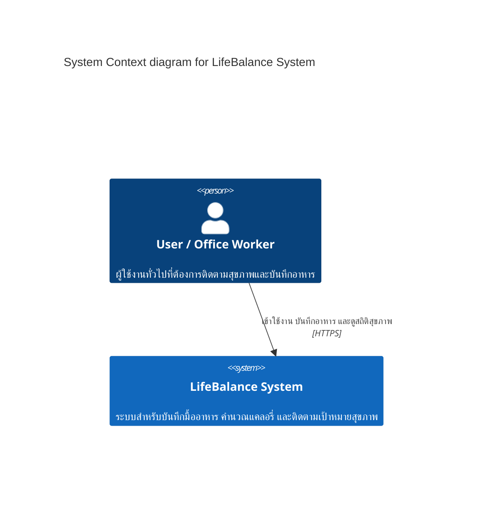
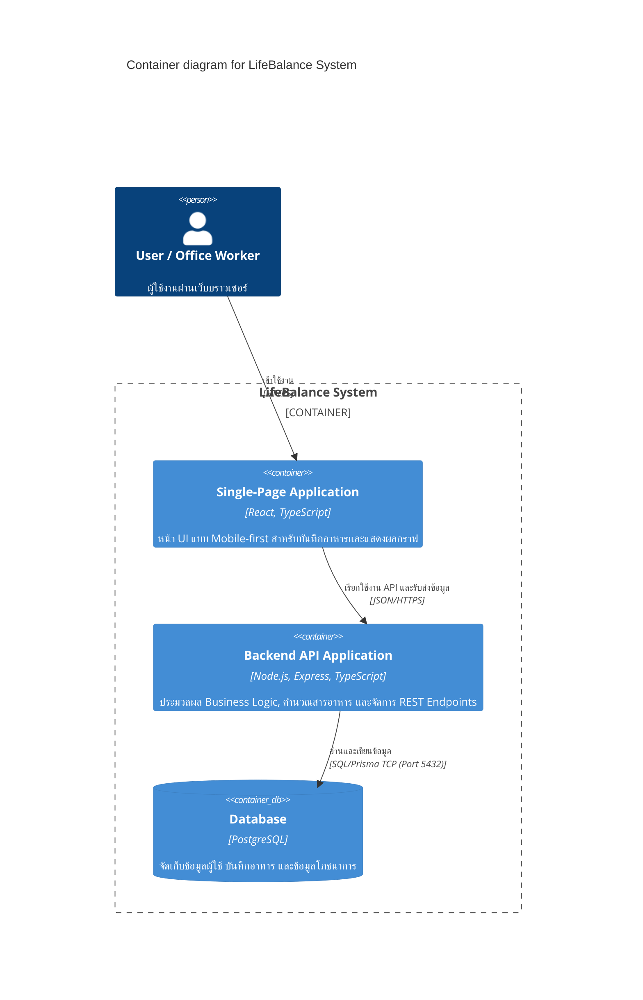

# Architectural Reflections (Post-Quiz 5)

## B1. Apply — ADR ฉบับแรก
- **Context:** ทีม LifeBalance มีขนาดเล็กและมีเวลาพัฒนาจำกัดในแต่ละ Sprint ต้องการส่งมอบฟังก์ชัน Food Logging และ Dashboard ให้เร็วที่สุด โดยไม่ต้องการสร้างภาระด้าน Infrastructure และการจัดการ Distributed Network
- **Decision:** เลือกสถาปัตยกรรมแบบ **Modular Monolith** สำหรับการพัฒนา Backend ในช่วงแรก แทนการใช้ Microservices
- **Consequences (1+1):**
  - *(+1 ข้อดี):* การพัฒนา การทดสอบ (Testing) และการ Deploy ไม่ซับซ้อน สามารถจัดการ Database Transactions ได้แบบรวมศูนย์
  - *(-1 ข้อเสีย/ข้อจำกัด):* ไม่สามารถแยก Scale เฉพาะบางโมดูลที่มีปริมาณการใช้งานสูงได้อย่างอิสระ

---

## B2. Connect — C4 Context + Container

### 1. C4 Context (Level 1)

### 2. C4 Container (Level 2)

---

## B3. Reflect — Tech Stack
- **Frontend (React + TypeScript):** เลือก React เพราะโครงสร้างแบบ Component-based ช่วยให้พัฒนาหน้า Mobile-first UI ที่มีการอัปเดต State บ่อย (เช่น การคำนวณแคลอรี่แบบ Real-time) ได้ลื่นไหลและจัดการโค้ดได้เป็นระบบ
- **Backend (Node.js + Express):** เลือก Node.js เพราะการทำงานแบบ Non-blocking I/O มีประสิทธิภาพสูงในการรับส่งข้อมูล JSON ขนาดเล็กผ่าน REST API และช่วยให้ทีมสามารถใช้ภาษา TypeScript ร่วมกันได้ทั้งหน้าบ้านและหลังบ้าน
- **Database (PostgreSQL):** เลือก PostgreSQL เพราะข้อมูลโภชนาการและบันทึกอาหารต้องการความถูกต้องของโครงสร้างและความสัมพันธ์ (Relational Integrity) สูง ป้องกันปัญหาข้อมูลสูญหายหรือไม่สอดคล้องกัน