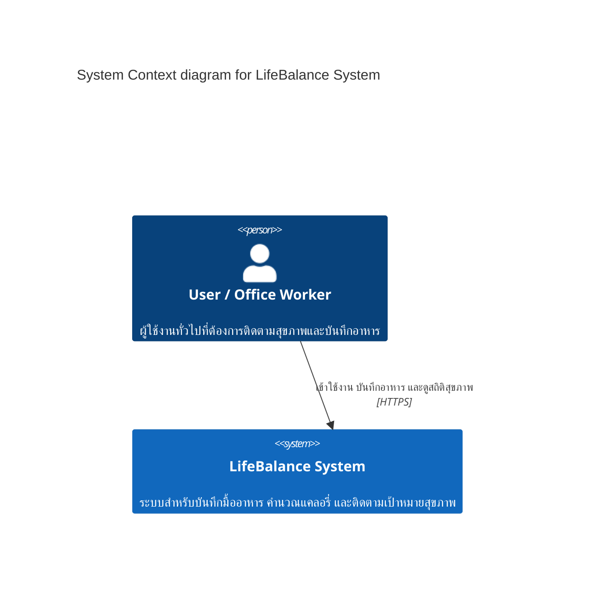
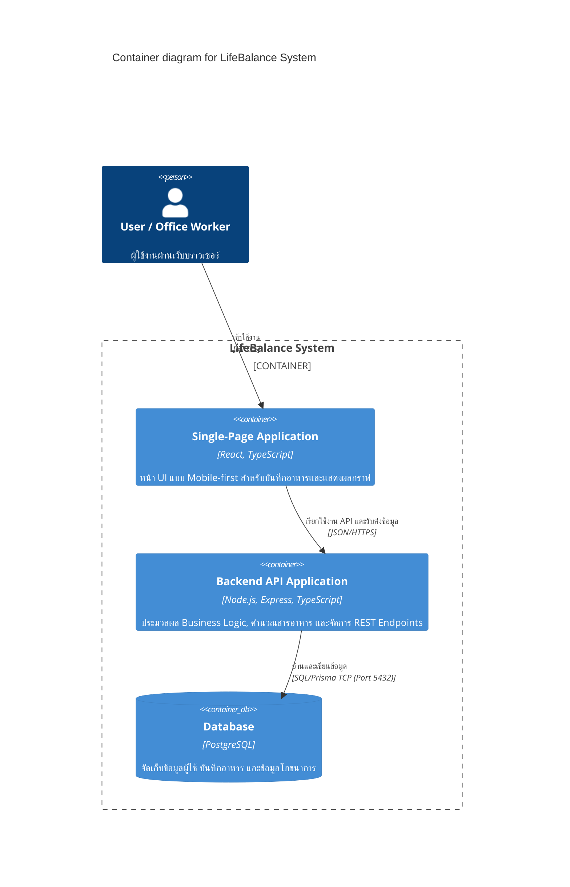

feature/lab3-requirements
# Lab 3 Reflection

## 1. What did I learn from Lab 3?

จากการทำ Lab 3 ได้เรียนรู้การแปลงความต้องการของผู้ใช้งานให้อยู่ในรูปแบบของ Persona, Scenario, User Story และ Non-functional Requirement (NFR)

ทำให้เข้าใจว่า User Story ไม่ควรเป็นเพียงรายการงานที่ระบบต้องทำ แต่ต้องระบุว่าผู้ใช้คือใคร ต้องการอะไร และต้องการสิ่งนั้นเพื่ออะไร รวมถึงต้องมี Acceptance Criteria ที่สามารถตรวจสอบผลลัพธ์ได้อย่างชัดเจน

นอกจากนี้ยังได้เรียนรู้การกำหนด Priority ด้วยแนวคิด MoSCoW และการกำหนด Estimate เพื่อช่วยจัดลำดับความสำคัญของงานใน Sprint

---

## 2. What was difficult?

ส่วนที่ยากคือการแยกความแตกต่างระหว่าง Functional Requirement และ Non-functional Requirement รวมถึงการเขียน Acceptance Criteria ให้สามารถวัดผลได้จริง

อีกส่วนหนึ่งคือการเชื่อมโยง Persona, Scenario และ User Story ให้สอดคล้องกัน และไม่เพิ่ม Feature ที่อยู่นอกขอบเขตของ Project Proposal

---

## 3. How did I solve the problems?

ทีมเริ่มจากการทบทวน Persona และ Project Proposal จากนั้นจึงสร้าง Scenarios จากพฤติกรรมและปัญหาของผู้ใช้ แล้วนำ Action ที่สำคัญจากแต่ละ Scenario มาแปลงเป็น User Stories

สำหรับ Acceptance Criteria ทีมใช้รูปแบบ Given/When/Then หรือ Checklist ที่สามารถตรวจสอบได้

สำหรับ NFR ทีมกำหนดเป็นค่าที่วัดผลได้ เช่น Response Time, Session Timeout, Availability และจำนวนผู้ใช้งานพร้อมกัน แทนการใช้คำอธิบายที่คลุมเครือ เช่น "เร็ว" หรือ "ปลอดภัย"

---

## 4. What would I improve?

หากทำ Lab นี้อีกครั้ง ทีมควรทำ User Research กับผู้ใช้งานจริงเพิ่มเติม เพื่อให้ Persona และ Scenario มีข้อมูลจากผู้ใช้จริงมากขึ้น

นอกจากนี้ควรตรวจสอบ Traceability ระหว่าง Persona → Scenario → User Story → NFR ตั้งแต่เริ่มต้น เพื่อป้องกัน Requirement ที่ซ้ำกันหรือไม่สอดคล้องกัน

---

## 5. Reflection on AI Usage

ทีมใช้ Generative AI เพื่อช่วยร่างและปรับปรุงเอกสาร Requirements เช่น Scenario, User Story, Acceptance Criteria และ NFR

ผลลัพธ์จาก AI ถูกนำมาตรวจสอบและปรับแก้โดยทีมให้สอดคล้องกับ Project Proposal, Persona และ User Stories ของทีมก่อนนำไปใช้จริง


# Exit Ticket — ท้ายบรรยาย Lab 4 (reflect.md)

## B1. Apply — Prompt Critique (Five S's)

### Prompt เดิมที่มีปัญหา:
> *"ช่วยเขียน code Python ที่ดีๆ หน่อย"*

### ปรับปรุงใหม่ตามหลัก Five S's (`calculate_discount`):
> *"คุณคือ Senior Python Developer (Set the scene) กรุณาเขียนฟังก์ชันชื่อ `calculate_discount(price: float, discount_percent: float, member_type: str) -> float` (Specific) เพื่อคำนวณราคาสินค้าสุทธิหลังหักส่วนลด โดยมีเงื่อนไขเพิ่มเติม: สมาชิกประเภท 'VIP' ได้รับส่วนลดเพิ่ม 5% จากราคาสุทธิ, ราคาและเปอร์เซ็นต์ต้องไม่ติดลบ (Short & Scope) พร้อมใส่ Type Hinting, Docstring และเขียน Unit Test ด้วย `pytest` ครอบคลุม Edge Cases เช่น ค่าติดลบ หรือส่วนลดเกิน 100% (Structured)"*

### คำอธิบายการปรับปรุง:
- **Set the scene:** กำหนดบทบาทชัดเจน (Senior Python Developer)
- **Specific & Scope:** ระบุชื่อฟังก์ชัน, Parameter types, Return type, Business logic (ส่วนลด VIP) และขอบเขตเงื่อนไขชัดเจน
- **Short:** กระชับ ไม่เยิ่นเย้อ
- **Structured:** กำหนดรูปแบบผลลัพธ์ที่ต้องการ (Docstring, Type hints, `pytest` cases)

---

## B2. Connect — AI ในงานที่ใช้

* **1 Task ที่ AI ช่วยได้จริง (Productive):**
  - **การสร้าง Boilerplate Code & Test Cases:** เช่น การให้ AI ช่วยเขียนโครงร่าง CRUD API, Mock ข้อมูล JSON สำหรับทดสอบ หรือสร้าง Unit Tests เพื่อครอบคลุม Edge Cases ต่างๆ ช่วยประหยัดเวลาในการพิมพ์โค้ดซ้ำซาก
* **1 Task ที่ AI ใช้ไม่ได้ / ไม่ควรใช้ (Non-productive / Risk):**
  - **การตัดสินใจเลือก System Architecture หรือ Business Trade-offs:** AI ไม่เข้าใจบริบทเชิงลึกของทีม ทรัพยากรที่มี หรือข้อจำกัดด้านงบประมาณ/เวลาจริง การให้ AI ตัดสินใจสถาปัตยกรรมทั้งหมดอาจนำไปสู่ Over-engineering หรือแก้ปัญหาไม่ตรงโจทย์ทางธุรกิจ

---

## B3. Reflect — AI Strategy (Starter Prototype Lab 4)

* **Step ที่จะใช้ AI:** ใช้ในขั้นตอน **Rapid UI Skeleton & Mock Data Generation** ของการทำ Starter Prototype
* **เหตุผล:** ในระยะเริ่มต้นของ Prototype (เช่น การทำหน้า Dashboard หรือฟอร์มบันทึกข้อมูล) การใช้ AI ช่วยสร้างโครงสร้าง HTML/CSS Layout และจำลองข้อมูลสถิติจะช่วยลดเวลาในการตั้งต้นลงอย่างมาก ทำให้ทีมสามารถนำเวลาไปโฟกัสกับการตรวจสอบ User Flow และทดสอบ Interactivity กับผู้ใช้งานจริงได้เร็วยิ่งขึ้น

# Lab5 Architectural Reflections (Post-Quiz 5)

## B1. Apply — ADR ฉบับแรก
- **Context:** ทีม LifeBalance มีขนาดเล็กและมีเวลาพัฒนาจำกัดในแต่ละ Sprint ต้องการส่งมอบฟังก์ชัน Food Logging และ Dashboard ให้เร็วที่สุด โดยไม่ต้องการสร้างภาระด้าน Infrastructure และการจัดการ Distributed Network
- **Decision:** เลือกสถาปัตยกรรมแบบ **Modular Monolith** สำหรับการพัฒนา Backend ในช่วงแรก แทนการใช้ Microservices
- **Consequences (1+1):**
  - *(+1 ข้อดี):* การพัฒนา การทดสอบ (Testing) และการ Deploy ไม่ซับซ้อน สามารถจัดการ Database Transactions ได้แบบรวมศูนย์
  - *(-1 ข้อเสีย/ข้อจำกัด):* ไม่สามารถแยก Scale เฉพาะบางโมดูลที่มีปริมาณการใช้งานสูงได้อย่างอิสระ

---

## B2. Connect — C4 Context + Container

### 1. C4 Context (Level 1)


### 2. C4 Container (Level 2)


---

## B3. Reflect — Tech Stack
- **Frontend (React + TypeScript):** เลือก React เพราะโครงสร้างแบบ Component-based ช่วยให้พัฒนาหน้า Mobile-first UI ที่มีการอัปเดต State บ่อย (เช่น การคำนวณแคลอรี่แบบ Real-time) ได้ลื่นไหลและจัดการโค้ดได้เป็นระบบ
- **Backend (Node.js + Express):** เลือก Node.js เพราะการทำงานแบบ Non-blocking I/O มีประสิทธิภาพสูงในการรับส่งข้อมูล JSON ขนาดเล็กผ่าน REST API และช่วยให้ทีมสามารถใช้ภาษา TypeScript ร่วมกันได้ทั้งหน้าบ้านและหลังบ้าน
- **Database (PostgreSQL):** เลือก PostgreSQL เพราะข้อมูลโภชนาการและบันทึกอาหารต้องการความถูกต้องของโครงสร้างและความสัมพันธ์ (Relational Integrity) สูง ป้องกันปัญหาข้อมูลสูญหายหรือไม่สอดคล้องกัน


# Lab 6 Reflection

## 1. Dockerfile

ใน Lab 6 ได้เรียนรู้การสร้าง Docker image สำหรับ Stats Service
ซึ่งเป็น REST API ที่พัฒนาด้วย Python และ FastAPI โดยเลือกใช้
`python:3.12-slim` เป็น Base Image เพื่อให้มีขนาด image ที่เหมาะสม

ได้เรียนรู้การกำหนด `WORKDIR`, `COPY`, `EXPOSE` และ `USER`
เพื่อให้ container สามารถทำงานได้อย่างถูกต้องและลดความเสี่ยงจาก
การรัน application ด้วย root user

หลังจากสร้าง Dockerfile ได้ทดสอบ Build image ด้วยคำสั่ง
`docker build` และพบว่า image สามารถสร้างได้สำเร็จ โดยมีขนาด
ประมาณ 244 MB ซึ่งต่ำกว่าเกณฑ์ 500 MB ที่กำหนดไว้ใน Lab

## 2. Service

Service ที่นำมา Containerize คือ `stats-service` ซึ่งเป็น REST API
สำหรับจัดการข้อมูลสถิติของระบบ

ก่อนสร้าง container ได้ทดสอบ service ในเครื่องด้วย Uvicorn และตรวจสอบ
endpoint `/health` ว่าสามารถตอบกลับสถานะ healthy ได้

หลังจากสร้าง Docker image แล้ว ได้ Run container โดย map port
8000 ของเครื่องเข้ากับ port 8000 ภายใน container และตรวจสอบด้วย
`docker ps` พบว่า container ทำงานอยู่ในสถานะ Up

จากการทดลองพบว่า Container เหมาะกับ Stats Service เพราะ service
สามารถทำงานแยกเป็นอิสระและสามารถ package application กับ dependencies
ไว้ใน image เดียว ทำให้สามารถนำไป deploy ใน environment อื่นได้ง่าย

## 3. REST Endpoint

หลังจาก Run container ได้ทดสอบ REST endpoint ของ Stats Service
ผ่าน browser

Endpoint ที่ทดสอบคือ:

- `GET /health` สำหรับตรวจสอบสถานะของ service
- `GET /stats` สำหรับเรียกข้อมูลสถิติ

ผลการทดสอบพบว่า endpoint สามารถตอบกลับได้สำเร็จ และ `/health`
ส่ง response:

```json
{
  "status": "healthy"
}
```
# Lap 7 Reflection
# B1.Apply — DRY Hunt
- Duplicate Code — index.html และ chayakorn_Food Logging_prototype.html มี CSS/JavaScript ซ้ำกัน
- Long Method — JavaScript บาง Function มีหลายขั้นตอน
- Large HTML Structure — HTML มีโค้ดหลายส่วนรวมอยู่ในไฟล์เดียว
- Repeated Logic — Event Listener มี Logic คล้ายกัน
- Tight Coupling — HTML และ JavaScript พึ่งพากันโดยตรง
# B2.Connect — Orthogonality Check 
## Module ที่ตรวจ: 
JavaScript ของ Food Logging
## ตรวจสอบ: 
ถ้าเปลี่ยน HTML เช่น id หรือโครงสร้าง Element → JavaScript ที่อ้างอิง Element นั้นอาจทำงานไม่ได้
## ปัญหา:
HTML และ JavaScript มี Coupling กัน
## วิธี Decoupling: 
แยก Logic เป็น Function/Module และแยก JavaScript ออกจาก HTML เพื่อลดการพึ่งพากัน
# B3.Reflect — Refactoring Plan
## Smell: Duplicate Code
## Before:
index.html และ chayakorn_Food Logging_prototype.html มี CSS/JavaScript ที่ซ้ำกัน
## After:
แยกโค้ดที่ใช้ร่วมกันเป็น common.css และ common.js
## ผลที่ได้: 
ลด Code Duplication แก้ไขง่ายขึ้น และสามารถ Reuse Code ได้
## Testing: 
เปิดทั้ง 2 หน้า ตรวจสอบ UI, JavaScript และ Browser Console ว่ายังทำงานปกติและไม่มี Error
## AI Workflow:
Explain → AI เสนอแนวทาง → ทีมตรวจสอบ Codebase → เลือกวิธี Refactor → Apply → Test

---

# Lab 9 — Testing and CI (draft for student review)

> สถานะ: เนื้อหาส่วนนี้เป็นร่างทางเทคนิคที่ต้องให้สมาชิกผู้ส่งงานตรวจ แก้เป็นประสบการณ์ของตนเอง และตอบคำถาม Post-quiz ตามใบงานก่อนส่ง ไม่ได้อ้างว่าเป็น reflection ส่วนบุคคลที่เสร็จแล้ว

## B1. Apply — Test design plan

แผนทดสอบของ `calculate_net_calories` แบ่ง input เป็น valid non-negative values และ invalid negative values ใช้ขอบเขต `0` กับค่าที่ต่ำกว่า 0 เล็กน้อย (`-0.01`) เพื่อให้เห็นจุดเปลี่ยนของเงื่อนไข การทดสอบครอบคลุมกรณีปกติ, ศูนย์, ค่าทศนิยม และ negative input ทั้งสองตำแหน่ง รายละเอียด decision table อยู่ที่ `docs/testing/lab9-test-plan.md`.

## B2. Connect — Property-based testing

ใช้ Hypothesis สร้างอย่างน้อย 150 ตัวอย่างต่อ property สำหรับ FizzBuzz 4 กลุ่ม: multiple of 15, multiple of 3 only, multiple of 5 only และเลขอื่นที่คืนเป็นข้อความ การทดลองกับ mutant ของเงื่อนไข `% 15` ให้ counterexample ที่ย่อลงเป็น `15`; บันทึกคำสั่งและผลอยู่ใน `docs/saboteur-journal.md`.

## B3. Reflect — CI and honest limits

workflow `Tests` ติดตั้ง dependency จาก `requirements-test.txt` แล้วบังคับ pytest coverage ขั้นต่ำ 90% เมื่อเปิด pull request หรือ push เข้า `main`. ผลรันปัจจุบันคือ 24 tests ผ่าน และ statement/branch coverage 100% สำหรับ module ใน scope.

หลักฐาน TDD เดิมมี RED commit `8b7d2f0` แต่ commit ถัดไปรวม implementation กับ tests จึงไม่ควรอ้างว่าเป็น Red-Green-Refactor ครบวงจร ยังคงมี cycle ใหม่สำหรับ boolean input ที่แยก Red (`53bbcd2`) และ Green (`17d8d1c`) ไว้ให้ตรวจสอบได้ ส่วนการบังคับ branch protection ต้องตั้งจากหน้า GitHub โดย repository administrator.
