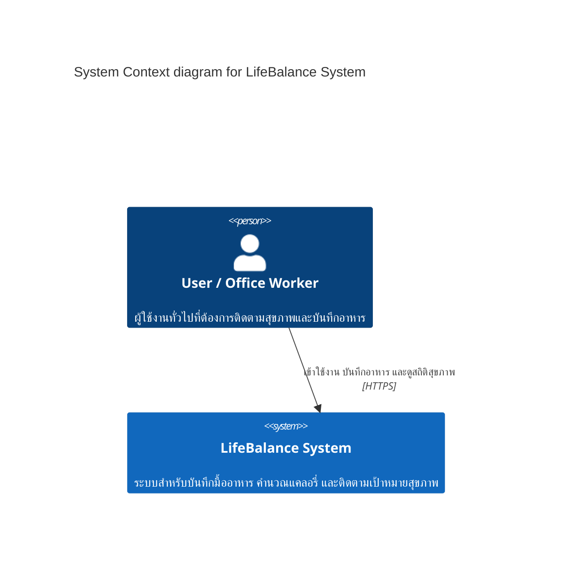
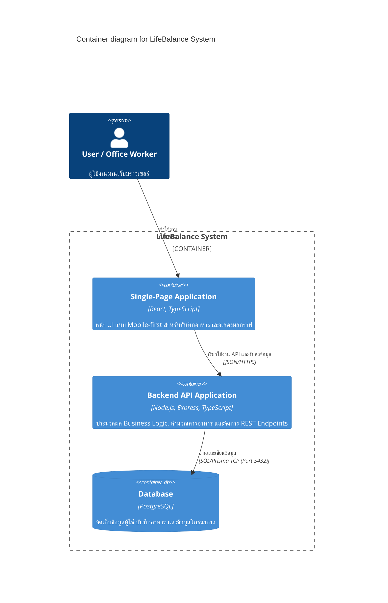

feature/lab3-requirements
# Lab 3 Reflection

## 1. What did I learn from Lab 3?

จากการทำ Lab 3 ได้เรียนรู้การแปลงความต้องการของผู้ใช้งานให้อยู่ในรูปแบบของ Persona, Scenario, User Story และ Non-functional Requirement (NFR)

ทำให้เข้าใจว่า User Story ไม่ควรเป็นเพียงรายการงานที่ระบบต้องทำ แต่ต้องระบุว่าผู้ใช้คือใคร ต้องการอะไร และต้องการสิ่งนั้นเพื่ออะไร รวมถึงต้องมี Acceptance Criteria ที่สามารถตรวจสอบผลลัพธ์ได้อย่างชัดเจน

นอกจากนี้ยังได้เรียนรู้การกำหนด Priority ด้วยแนวคิด MoSCoW และการกำหนด Estimate เพื่อช่วยจัดลำดับความสำคัญของงานใน Sprint

---

## 2. What was difficult?

ส่วนที่ยากคือการแยกความแตกต่างระหว่าง Functional Requirement และ Non-functional Requirement รวมถึงการเขียน Acceptance Criteria ให้สามารถวัดผลได้จริง

อีกส่วนหนึ่งคือการเชื่อมโยง Persona, Scenario และ User Story ให้สอดคล้องกัน และไม่เพิ่ม Feature ที่อยู่นอกขอบเขตของ Project Proposal

---

## 3. How did I solve the problems?

ทีมเริ่มจากการทบทวน Persona และ Project Proposal จากนั้นจึงสร้าง Scenarios จากพฤติกรรมและปัญหาของผู้ใช้ แล้วนำ Action ที่สำคัญจากแต่ละ Scenario มาแปลงเป็น User Stories

สำหรับ Acceptance Criteria ทีมใช้รูปแบบ Given/When/Then หรือ Checklist ที่สามารถตรวจสอบได้

สำหรับ NFR ทีมกำหนดเป็นค่าที่วัดผลได้ เช่น Response Time, Session Timeout, Availability และจำนวนผู้ใช้งานพร้อมกัน แทนการใช้คำอธิบายที่คลุมเครือ เช่น "เร็ว" หรือ "ปลอดภัย"

---

## 4. What would I improve?

หากทำ Lab นี้อีกครั้ง ทีมควรทำ User Research กับผู้ใช้งานจริงเพิ่มเติม เพื่อให้ Persona และ Scenario มีข้อมูลจากผู้ใช้จริงมากขึ้น

นอกจากนี้ควรตรวจสอบ Traceability ระหว่าง Persona → Scenario → User Story → NFR ตั้งแต่เริ่มต้น เพื่อป้องกัน Requirement ที่ซ้ำกันหรือไม่สอดคล้องกัน

---

## 5. Reflection on AI Usage

ทีมใช้ Generative AI เพื่อช่วยร่างและปรับปรุงเอกสาร Requirements เช่น Scenario, User Story, Acceptance Criteria และ NFR

ผลลัพธ์จาก AI ถูกนำมาตรวจสอบและปรับแก้โดยทีมให้สอดคล้องกับ Project Proposal, Persona และ User Stories ของทีมก่อนนำไปใช้จริง

# Architectural Reflections (Post-Quiz 5)

## B1. Apply — ADR ฉบับแรก
- **Context:** ทีม LifeBalance มีขนาดเล็กและมีเวลาพัฒนาจำกัดในแต่ละ Sprint ต้องการส่งมอบฟังก์ชัน Food Logging และ Dashboard ให้เร็วที่สุด โดยไม่ต้องการสร้างภาระด้าน Infrastructure และการจัดการ Distributed Network
- **Decision:** เลือกสถาปัตยกรรมแบบ **Modular Monolith** สำหรับการพัฒนา Backend ในช่วงแรก แทนการใช้ Microservices
- **Consequences (1+1):**
  - *(+1 ข้อดี):* การพัฒนา การทดสอบ (Testing) และการ Deploy ไม่ซับซ้อน สามารถจัดการ Database Transactions ได้แบบรวมศูนย์
  - *(-1 ข้อเสีย/ข้อจำกัด):* ไม่สามารถแยก Scale เฉพาะบางโมดูลที่มีปริมาณการใช้งานสูงได้อย่างอิสระ

---

## B2. Connect — C4 Context + Container

### 1. C4 Context (Level 1)

### 2. C4 Container (Level 2)

---

## B3. Reflect — Tech Stack
- **Frontend (React + TypeScript):** เลือก React เพราะโครงสร้างแบบ Component-based ช่วยให้พัฒนาหน้า Mobile-first UI ที่มีการอัปเดต State บ่อย (เช่น การคำนวณแคลอรี่แบบ Real-time) ได้ลื่นไหลและจัดการโค้ดได้เป็นระบบ
- **Backend (Node.js + Express):** เลือก Node.js เพราะการทำงานแบบ Non-blocking I/O มีประสิทธิภาพสูงในการรับส่งข้อมูล JSON ขนาดเล็กผ่าน REST API และช่วยให้ทีมสามารถใช้ภาษา TypeScript ร่วมกันได้ทั้งหน้าบ้านและหลังบ้าน
- **Database (PostgreSQL):** เลือก PostgreSQL เพราะข้อมูลโภชนาการและบันทึกอาหารต้องการความถูกต้องของโครงสร้างและความสัมพันธ์ (Relational Integrity) สูง ป้องกันปัญหาข้อมูลสูญหายหรือไม่สอดคล้องกัน

